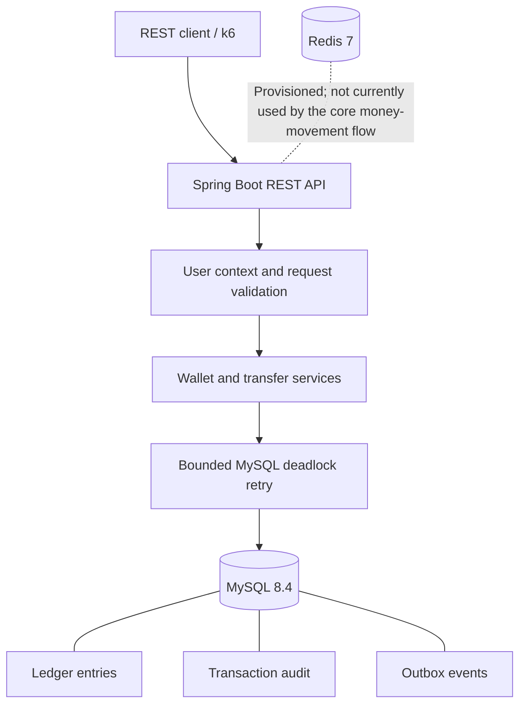
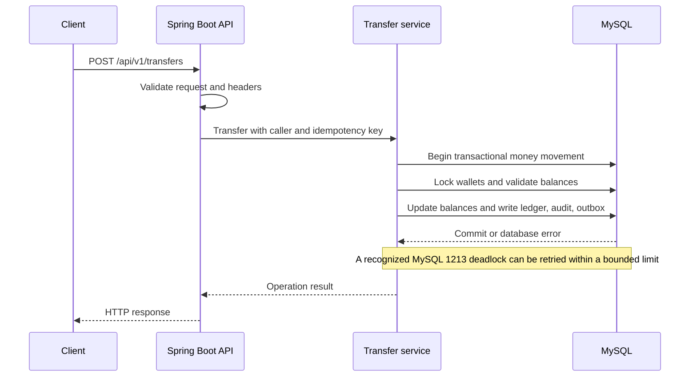

# WalletLedger

## Highlights

- Phase 1 transaction reversals are implemented. Isolated Phase 1 verification passed: 112 tests, 0 failures, 0 errors, 0 skipped. The combined working-tree run passed 113 tests.
- 2,000 opposite-direction concurrent transfers tested, plus a forced real-MySQL error 1213 deadlock recovery test.
- Two per-scenario k6 runs completed 6,181 iterations up to 25 VUs, with 0% reported HTTP failures and zero integrity violations afterward.
- Double-entry ledger postings, transaction audit records, and outbox events are written within the same transaction.

A production-style REST backend for wallet operations, built with Java 21, Spring Boot, and MySQL. The project focuses on correct money movement under retries and concurrency, with an auditable ledger and database integrity checks.

## What it does

WalletLedger supports user and wallet creation, balance queries, top-ups, withdrawals, transfers, and transaction reversals. Money movement uses idempotency keys, transactional database operations, wallet locking, bounded MySQL deadlock retries, and ledger/audit/outbox records.

## Architecture



## Money-transfer flow



The exact transaction and locking behavior is implemented in the application services. The diagrams are a high-level overview, not a replacement for the source code.

## Technology

- Java 21
- Spring Boot 4.1.1
- Maven
- MySQL 8.4
- Flyway database migrations
- Redis 7 provisioned through Docker Compose
- Testcontainers for integration testing
- k6 for concurrency and performance experiments
- OpenAPI / Swagger UI

## Key design decisions

- Store monetary amounts as integer paise rather than floating-point values.
- Generate UUIDs in the application; wallet/user identifiers use the project's database mapping.
- Use MySQL transactions and wallet locking for money movement.
- Require idempotency keys for top-ups, withdrawals, transfers, and reversals.
- Keep ledger entries, transaction audit records, and outbox events in the database transaction.
- Apply bounded retries to recognized MySQL deadlock error 1213.
- Use a separate application database account with restricted permissions; Flyway uses the owner account.
- Keep fraud detection out of this version. The outbox is prepared for future integration, but a fraud engine and outbox publisher are not implemented here.

See [DECISIONS.md](DECISIONS.md) for the fuller record of design decisions and the Module 4C benchmark/integrity notes.

## Prerequisites

- Docker Desktop with Docker Compose
- A local `.env` file configured for this project
- For running the application outside Docker: Java 21 and the Maven wrapper included in the repository
- For running the load tests: k6

Do not commit or share the real `.env` file. Use `.env.example` as the configuration template and fill in the required values locally.

## Run with Docker Compose

From the project root in PowerShell:

```powershell
Copy-Item .env.example .env
# Edit .env and set the required local configuration values.
docker compose config --quiet
docker compose up -d --build
docker compose ps
docker compose logs --tail 100 app
```

The `Copy-Item` command is only for initial setup. If you already have a `.env`, do not overwrite it; edit your existing file instead.

Configured host ports:

| Service | Host port | Purpose |
|---|---:|---|
| Spring Boot API | 8081 | REST API |
| MySQL | 3307 | Database |
| Redis | 6380 | Redis |

The application container depends on its configured service health checks. Confirm the actual service names in `compose.yaml` if your local configuration differs.

### Health and API documentation

When the app is running:

- Readiness: `http://localhost:8081/actuator/health/readiness`
- Swagger UI: `http://localhost:8081/swagger-ui/index.html`

Check the health endpoint and Docker logs if the API does not start. Do not assume the service is ready just because its container exists.

### Stop the services

```powershell
docker compose down
```

This stops and removes the Compose containers and network. It does not intentionally remove named volumes. Do not add `-v` unless you deliberately want to delete the database volume and its data.

## Run and test without Dockerizing the application

Start the required MySQL and Redis services using your configured local setup, then run from the project root:

```powershell
.\mvnw.cmd clean verify
```

The 97-test result is a historical v1.0 checkpoint. An earlier combined working-tree checkpoint passed 113 tests, and the isolated Phase 1 snapshot passed 112 tests. The latest full working-tree verification on 2026-10-25 passed 140 tests, 0 failures, 0 errors, and 0 skipped. The project retains its Surefire `forkCount=0` workaround because removing it caused a fork-startup failure in this environment.

To start Spring Boot from Maven:

```powershell
.\mvnw.cmd spring-boot:run
```

This runs the application through Maven, not from the packaged production JAR.

## REST API

Base URL for the local Docker setup: `http://localhost:8081`

| Method | Endpoint | Purpose |
|---|---|---|
| `POST` | `/api/v1/users` | Register a user with a password |
| `POST` | `/api/v1/auth/login` | Log in and obtain a JWT access token |
| `POST` | `/api/v1/wallets` | Create a wallet for the authenticated caller |
| `GET` | `/api/v1/wallets/{id}/balance` | Retrieve wallet information/balance |
| `POST` | `/api/v1/wallets/{id}/topup` | Top up a wallet |
| `POST` | `/api/v1/wallets/{id}/withdraw` | Withdraw from a wallet |
| `POST` | `/api/v1/transfers` | Transfer funds between wallets |
| `POST` | `/api/v1/transactions/{id}/reverse` | Reverse an eligible completed transaction |

Registration requires `name`, `email`, and `password`. Log in at `/api/v1/auth/login` to obtain a JWT. Protected `/api/**` endpoints require `Authorization: Bearer <token>`; a caller-supplied `X-User-Id` header is not accepted as authentication. Top-ups, withdrawals, transfers, and reversals require an `Idempotency-Key` header. Only the original transaction initiator may reverse an eligible completed transaction.

Amounts are expressed in **paise**. For example, `10000` paise equals INR 100.00.

### Example requests using Windows PowerShell

These examples use `curl.exe` explicitly because PowerShell may otherwise resolve `curl` to a different command.

Set the base URL:

```powershell
$base = 'http://localhost:8081'
```

#### 1. Create a user

```powershell
curl.exe -i -X POST "$base/api/v1/users" `
  -H 'Content-Type: application/json' `
  -d '{"name":"Alice","email":"alice@example.com","password":"ValidPassword123!"}'
```

The endpoint returns `201 Created`. Next, log in with the registered credentials and retain the access token for protected requests:

```powershell
$login = Invoke-RestMethod -Method Post -Uri "$base/api/v1/auth/login" `
  -ContentType 'application/json' `
  -Body '{"email":"alice@example.com","password":"ValidPassword123!"}'

$token = $login.accessToken
$authHeader = "Authorization: Bearer $token"
```

#### 2. Create a wallet

```powershell
curl.exe -i -X POST "$base/api/v1/wallets" `
  -H $authHeader
```

Copy the returned wallet UUID:

```powershell
$walletId = 'PASTE-RETURNED-WALLET-UUID-HERE'
```

Create a second user and wallet in the same way if you want to test a transfer between two wallets. Use the actual IDs returned by the API; the example IDs above are placeholders.

#### 3. Check a wallet balance

```powershell
curl.exe -i "$base/api/v1/wallets/$walletId/balance" `
  -H $authHeader
```

#### 4. Top up a wallet

Use a new idempotency key for a new logical operation:

```powershell
curl.exe -i -X POST "$base/api/v1/wallets/$walletId/topup" `
  -H $authHeader `
  -H 'Idempotency-Key: demo-topup-001' `
  -H 'Content-Type: application/json' `
  -d '{"amountPaise":10000}'
```

This example requests a top-up of INR 100.00.

#### 5. Withdraw from a wallet

```powershell
curl.exe -i -X POST "$base/api/v1/wallets/$walletId/withdraw" `
  -H $authHeader `
  -H 'Idempotency-Key: demo-withdraw-001' `
  -H 'Content-Type: application/json' `
  -d '{"amountPaise":1000}'
```

This example requests a withdrawal of INR 10.00. The wallet must satisfy the service's balance and validation rules.

#### 6. Transfer between wallets

Set the source and destination IDs to two valid wallets owned by the appropriate users:

```powershell
$sourceWalletId = 'PASTE-SOURCE-WALLET-UUID-HERE'
$destinationWalletId = 'PASTE-DESTINATION-WALLET-UUID-HERE'
```

Then submit the transfer:

```powershell
curl.exe -i -X POST "$base/api/v1/transfers" `
  -H $authHeader `
  -H 'Idempotency-Key: demo-transfer-001' `
  -H 'Content-Type: application/json' `
  -d "{`"sourceWalletId`":`"$sourceWalletId`",`"destinationWalletId`":`"$destinationWalletId`",`"amountPaise`":1000}"
```

This example requests a transfer of INR 10.00. Replace the sample idempotency key when initiating a distinct operation. For a retry of the same logical request, reuse the original key and request details.

#### 6. Reverse a completed transaction

Use the original transaction ID returned by a successful top-up, withdrawal, or transfer. The caller must be the original transaction's initiator.

```powershell
$transactionId = "REPLACE-WITH-ORIGINAL-TRANSACTION-UUID"

curl.exe -i -X POST "$base/api/v1/transactions/$transactionId/reverse" `
  -H $authHeader `
  -H 'Idempotency-Key: demo-reversal-001'
```

**Authentication note:** Protected API requests use signed JWT bearer tokens. Treat access tokens as secrets. The 15-minute default token lifetime does not replace production secret rotation, TLS, authorization review, rate limiting, or other operational security controls.

## Testing and correctness

Latest verified Maven build:

| Result | Count |
|---|---:|
| Test classes | 27 |
| Tests run | 140 |
| Failures | 0 |
| Errors | 0 |
| Skipped | 0 |

The test suite covers the project's implemented functionality, including request validation, wallet operations, transfer behavior, idempotency, transaction rollback, ledger/audit/outbox behavior, concurrency and integrity checks. A real MySQL deadlock test forces error `1213` and verifies recovery through the bounded retry executor.

Concurrency and integrity evidence includes:

- High-volume concurrent transfer tests.
- Opposite-direction transfer tests.
- Checks of transaction-level invariants.
- Wallet cached-balance reconciliation against ledger totals.
- A global wallet-balance sum check.
- Tests that detect deliberately corrupted cached balances and missing ledger entries.

These tests establish evidence for the implemented cases; they do not prove correctness under every possible production workload or infrastructure failure.

## Benchmark results

Both benchmarks ran on one laptop, with the application and MySQL running through Docker Compose and k6 running from the host. These are local development measurements, not production capacity guarantees.

### Test environment

| Item | Recorded value |
|---|---|
| CPU | Intel Core i5-9300H, 4 cores / 8 threads |
| RAM | 15.9 GB |
| Storage | NVMe SSD |
| Hikari connection pool | 10 |
| Database | MySQL 8.4 |
| Application launch | Docker Compose |
| Benchmark date | 2026-10-26 |

### Latest rerun results

| Metric | Hot pair | Wallet pool |
|---|---:|---:|
| Workload | 2 wallets | 10 wallets |
| Load pattern | 5 constant VUs, 30 seconds | Ramp up to 25 VUs over 100 seconds |
| Completed iterations | 1,118 | 5,736 |
| HTTP request rate | 34.50 req/s | 56.51 req/s |
| HTTP request failures | 0% | 0% |
| HTTP request duration p90 | 70.86 ms | 114.82 ms |
| HTTP request duration p95 | 87.48 ms | 197.81 ms |
| HTTP request duration p99 | 113.56 ms | 422.21 ms |
| Unexpected 4xx responses | 0 | 0 |
| Unexpected 5xx responses | 0 | 0 |
| Unexpected other responses | 0 | 0 |
| k6 process exit code | 0 | 0 |
| InnoDB deadlock counter | 0 -> 0 | 0 -> 0 |
| SQL integrity checks | 0 violations | 0 violations |

The hot-pair scenario concentrates transfers on two wallets to exercise contention. The wallet-pool scenario distributes transfers across ten wallets and ramps virtual users up to 25.

**Threshold interpretation:** The k6 script defines thresholds for HTTP request failure rate, p95 request duration below 500 ms, and zero unexpected response counts. Both reported runs exited with code 0; their reported p95 values were below 500 ms, and the unexpected response counts were zero. Do not interpret a saved threshold flag in isolation as evidence that a threshold passed.

The latency percentiles and HTTP request rate come from k6's HTTP request metrics, which include setup requests as well as transfer requests. Completed iterations represent executions of the transfer iteration function. These results are specific to this local machine and workload.

### Post-benchmark integrity checks

After both reruns, the four SQL checks reported:

- Transaction-to-ledger violations: 0
- Wallet cached-balance versus ledger mismatches: 0
- Negative USER wallet balances: 0
- Global sum of wallet balances: 0 paise

The InnoDB deadlock counter also remained at zero during each measured run. These checks support the observed results but do not prove correctness under every possible workload or failure condition.

## Security and operational limitations

- JWT bearer authentication is implemented; production hardening, including secret rotation, TLS enforcement, rate limiting, and a security review, remains necessary.
- A shared system wallet can become a contention hotspot.
- The benchmarks ran on a single machine; they are not distributed production benchmarks.
- Redis is provisioned but is not currently used by the core money-movement flow.
- Outbox events are recorded, but a production outbox publisher and delivery/retry workflow are not implemented.
- No fraud detection engine is included in this version.
- Transaction reversals are implemented in Phase 1; customer statements and API rate limiting are not implemented.
- Production deployment still requires proper identity, authorization, secrets management, monitoring, operational recovery procedures and security review.

## Next steps

1. Harden authentication and authorization for production deployment, including secret rotation, TLS, and security review.
2. Implement an outbox publisher with reliable delivery, retries and observability.
3. Add API rate limiting and operational monitoring.
4. Add customer statement APIs.
5. Rerun the k6 scenarios in a dedicated environment using the packaged Docker application, and document the environment and limits.
6. Consider fraud detection as a separate future module, consuming published events rather than adding fraud logic to this version.

## Project status

WalletLedger's current implemented scope includes transactional wallet operations, idempotent money movement, Phase 1 transaction reversals, ledger/audit/outbox integration, bounded deadlock retry, concurrency/integrity tests, and JWT bearer authentication. The latest full working-tree verification on 2026-10-25 passed 140 tests, with 0 failures, 0 errors, and 0 skipped. Earlier checkpoints passed 113 combined working-tree tests and 112 tests in the isolated Phase 1 snapshot.

The repository is published on GitHub for review and demonstration. The implemented scope, verification evidence, and known limitations are documented above. Benchmark results are local observations and do not establish production capacity.
