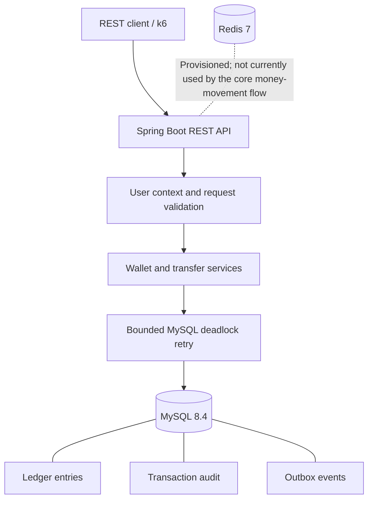
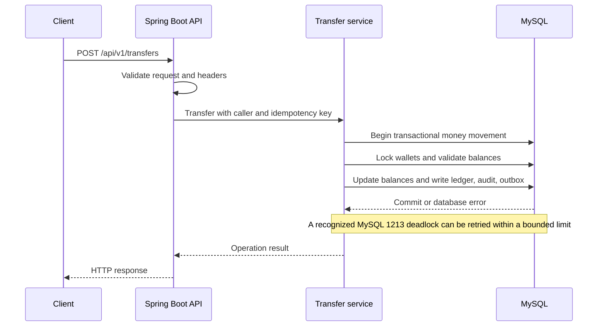

# WalletLedger

A production-style REST backend for wallet operations, built with Java 21, Spring Boot, and MySQL. The project focuses on correct money movement under retries and concurrency, with an auditable ledger and database integrity checks.

## What it does

WalletLedger supports user and wallet creation, balance queries, top-ups, withdrawals, and transfers. Money movement uses idempotency keys, transactional database operations, wallet locking, bounded MySQL deadlock retries, and ledger/audit/outbox records.

## Architecture



## Money-transfer flow



The exact transaction and locking behavior is implemented in the application services. The diagrams are a high-level overview, not a replacement for the source code.

## Technology

- Java 21
- Spring Boot 4.1.1
- Maven
- MySQL 8.4
- Flyway database migrations
- Redis 7 provisioned through Docker Compose
- Testcontainers for integration testing
- k6 for concurrency and performance experiments
- OpenAPI / Swagger UI

## Key design decisions

- Store monetary amounts as integer paise rather than floating-point values.
- Generate UUIDs in the application; wallet/user identifiers use the project's database mapping.
- Use MySQL transactions and wallet locking for money movement.
- Require idempotency keys for top-ups, withdrawals, and transfers.
- Keep ledger entries, transaction audit records, and outbox events in the database transaction.
- Apply bounded retries to recognized MySQL deadlock error 1213.
- Use a separate application database account with restricted permissions; Flyway uses the owner account.
- Keep fraud detection out of this version. The outbox is prepared for future integration, but a fraud engine and outbox publisher are not implemented here.

See [DECISIONS.md](DECISIONS.md) for the fuller record of design decisions and the Module 4C benchmark/integrity notes.

## Prerequisites

- Docker Desktop with Docker Compose
- A local `.env` file configured for this project
- For running the application outside Docker: Java 21 and the Maven wrapper included in the repository
- For running the load tests: k6

Do not commit or share the real `.env` file. Use `.env.example` as the configuration template and fill in the required values locally.

## Run with Docker Compose

From the project root in PowerShell:

```powershell
Copy-Item .env.example .env
# Edit .env and set the required local configuration values.
docker compose config --quiet
docker compose up -d --build
docker compose ps
docker compose logs --tail 100 app
```

The `Copy-Item` command is only for initial setup. If you already have a `.env`, do not overwrite it; edit your existing file instead.

Configured host ports:

| Service | Host port | Purpose |
|---|---:|---|
| Spring Boot API | 8081 | REST API |
| MySQL | 3307 | Database |
| Redis | 6380 | Redis |

The application container depends on its configured service health checks. Confirm the actual service names in `compose.yaml` if your local configuration differs.

### Health and API documentation

When the app is running:

- Readiness: `http://localhost:8081/actuator/health/readiness`
- Swagger UI: `http://localhost:8081/swagger-ui/index.html`

Check the health endpoint and Docker logs if the API does not start. Do not assume the service is ready just because its container exists.

### Stop the services

```powershell
docker compose down
```

This stops and removes the Compose containers and network. It does not intentionally remove named volumes. Do not add `-v` unless you deliberately want to delete the database volume and its data.

## Run and test without Dockerizing the application

Start the required MySQL and Redis services using your configured local setup, then run from the project root:

```powershell
.\mvnw.cmd clean verify
```

The verified Windows build completed with **97 tests, zero failures, zero errors, and zero skipped tests**. The project retains its Surefire `forkCount=0` workaround because removing it caused a fork-startup failure in this environment.

To start Spring Boot from Maven:

```powershell
.\mvnw.cmd spring-boot:run
```

This runs the application through Maven, not from the packaged production JAR.

## REST API

Base URL for the local Docker setup: `http://localhost:8081`

| Method | Endpoint | Purpose |
|---|---|---|
| `POST` | `/api/v1/users` | Create a user |
| `POST` | `/api/v1/wallets` | Create a wallet for the caller |
| `GET` | `/api/v1/wallets/{id}/balance` | Retrieve wallet information/balance |
| `POST` | `/api/v1/wallets/{id}/topup` | Top up a wallet |
| `POST` | `/api/v1/wallets/{id}/withdraw` | Withdraw from a wallet |
| `POST` | `/api/v1/transfers` | Transfer funds between wallets |

The user-creation request requires `name` and `email`. Wallet-scoped operations and transfers use the `X-User-Id` header. Top-ups, withdrawals, and transfers also require an `Idempotency-Key` header.

Amounts are expressed in **paise**. For example, `10000` paise equals INR 100.00.

### Example requests using Windows PowerShell

These examples use `curl.exe` explicitly because PowerShell may otherwise resolve `curl` to a different command.

Set the base URL:

```powershell
$base = 'http://localhost:8081'
```

#### 1. Create a user

```powershell
curl.exe -i -X POST "$base/api/v1/users" `
  -H 'Content-Type: application/json' `
  -d '{"name":"Alice","email":"alice@example.com"}'
```

The endpoint returns `201 Created`. Copy the actual user UUID from the response according to the response schema returned by your running application:

```powershell
$userId = 'PASTE-RETURNED-USER-UUID-HERE'
```

#### 2. Create a wallet

```powershell
curl.exe -i -X POST "$base/api/v1/wallets" `
  -H "X-User-Id: $userId"
```

Copy the returned wallet UUID:

```powershell
$walletId = 'PASTE-RETURNED-WALLET-UUID-HERE'
```

Create a second user and wallet in the same way if you want to test a transfer between two wallets. Use the actual IDs returned by the API; the example IDs above are placeholders.

#### 3. Check a wallet balance

```powershell
curl.exe -i "$base/api/v1/wallets/$walletId/balance" `
  -H "X-User-Id: $userId"
```

#### 4. Top up a wallet

Use a new idempotency key for a new logical operation:

```powershell
curl.exe -i -X POST "$base/api/v1/wallets/$walletId/topup" `
  -H "X-User-Id: $userId" `
  -H 'Idempotency-Key: demo-topup-001' `
  -H 'Content-Type: application/json' `
  -d '{"amountPaise":10000}'
```

This example requests a top-up of INR 100.00.

#### 5. Withdraw from a wallet

```powershell
curl.exe -i -X POST "$base/api/v1/wallets/$walletId/withdraw" `
  -H "X-User-Id: $userId" `
  -H 'Idempotency-Key: demo-withdraw-001' `
  -H 'Content-Type: application/json' `
  -d '{"amountPaise":1000}'
```

This example requests a withdrawal of INR 10.00. The wallet must satisfy the service's balance and validation rules.

#### 6. Transfer between wallets

Set the source and destination IDs to two valid wallets owned by the appropriate users:

```powershell
$sourceWalletId = 'PASTE-SOURCE-WALLET-UUID-HERE'
$destinationWalletId = 'PASTE-DESTINATION-WALLET-UUID-HERE'
```

Then submit the transfer:

```powershell
curl.exe -i -X POST "$base/api/v1/transfers" `
  -H "X-User-Id: $userId" `
  -H 'Idempotency-Key: demo-transfer-001' `
  -H 'Content-Type: application/json' `
  -d "{`"sourceWalletId`":`"$sourceWalletId`",`"destinationWalletId`":`"$destinationWalletId`",`"amountPaise`":1000}"
```

This example requests a transfer of INR 10.00. Replace the sample idempotency key when initiating a distinct operation. For a retry of the same logical request, reuse the original key and request details.

**Important:** `X-User-Id` is caller-supplied in this version. It is not authentication and must not be treated as a secure identity mechanism in a production deployment.

## Testing and correctness

Latest verified Maven build:

| Result | Count |
|---|---:|
| Test classes | 21 |
| Tests run | 97 |
| Failures | 0 |
| Errors | 0 |
| Skipped | 0 |

The test suite covers the project's implemented functionality, including request validation, wallet operations, transfer behavior, idempotency, transaction rollback, ledger/audit/outbox behavior, concurrency and integrity checks. A real MySQL deadlock test forces error `1213` and verifies recovery through the bounded retry executor.

Concurrency and integrity evidence includes:

- High-volume concurrent transfer tests.
- Opposite-direction transfer tests.
- Checks of transaction-level invariants.
- Wallet cached-balance reconciliation against ledger totals.
- A global wallet-balance sum check.
- Tests that detect deliberately corrupted cached balances and missing ledger entries.

These tests establish evidence for the implemented cases; they do not prove correctness under every possible production workload or infrastructure failure.

## Benchmark results

Both benchmarks ran on one laptop, with the application, k6 and MySQL sharing the same machine. The application was launched with `.\mvnw.cmd spring-boot:run`, not from a packaged JAR.

### Test environment

| Item | Recorded value |
|---|---|
| CPU | Intel Core i5-9300H, 4 cores / 8 threads |
| RAM | 15.9 GB |
| Storage | NVMe SSD |
| Hikari connection pool | 10 |
| Database | MySQL 8.4 |
| Application launch | Maven `spring-boot:run` |

### Results

| Metric | Hot pair | Wallet pool |
|---|---:|---:|
| Workload | 2 wallets | 10 wallets |
| Load pattern | 5 constant VUs, 30 seconds | 5 → 10 → 25 VUs, 100 seconds |
| Transfers | 1,088 | 5,093 |
| Throughput | 35.75 req/s | 50.88 req/s |
| p50 latency | 30.4 ms | 47.5 ms |
| p90 latency | 56.3 ms | 176.7 ms |
| p95 latency | 76.8 ms | 222.7 ms |
| p99 latency | 118.6 ms | 299.7 ms |
| Request failures reported by k6 | 0% | 0% |
| k6 process exit code | 0 | 0 |
| InnoDB deadlock counter increase | 0 | 0 |
| SQL integrity checks after run | 0 violations | 0 violations |

The hot-pair scenario concentrates traffic on two wallets and exercises contention. The wallet-pool scenario distributes work over more wallets and increases virtual users over time.

**Benchmark caveat:** Both k6 processes exited with code 0. The saved JSON threshold flags are false, and a diagnostic confirmed that false represents a passing threshold in this k6 summary format. However, other fields in the saved summaries were recorded as internally inconsistent in the validation notes. The threshold interpretation is clarified, but the summaries have not been fully reconciled or independently validated. These are local development measurements, not production capacity guarantees.

## Security and operational limitations

- `X-User-Id` is spoofable and is not a substitute for authentication and authorization.
- A shared system wallet can become a contention hotspot.
- The benchmarks ran on a single machine; they are not distributed production benchmarks.
- Redis is provisioned but is not currently used by the core money-movement flow.
- Outbox events are recorded, but a production outbox publisher and delivery/retry workflow are not implemented.
- No fraud detection engine is included in this version.
- Reversals, customer statements and API rate limiting are not implemented.
- Production deployment still requires proper identity, authorization, secrets management, monitoring, operational recovery procedures and security review.

## Next steps

1. Add authenticated identity and enforce wallet ownership at the API boundary.
2. Implement an outbox publisher with reliable delivery, retries and observability.
3. Add API rate limiting and operational monitoring.
4. Design reversals and customer statement APIs.
5. Investigate the k6 threshold configuration and rerun reproducible benchmark scenarios.
6. Run load tests on a dedicated environment and document the environment and limits.
7. Consider fraud detection as a separate future module, consuming published events rather than adding fraud logic to this version.

## Project status

WalletLedger's current implemented scope is a transactional wallet backend with idempotent money movement, ledger/audit/outbox integration, bounded deadlock retry, and concurrency/integrity tests. The current verified test baseline is 97 passing tests.

The repository is published on GitHub for review and demonstration. The implemented scope, verification evidence, and known limitations are documented above. Benchmark results are local observations; the k6 threshold-reporting discrepancy remains unresolved.
